# 외부 공개와 시청자 신청 페이지

[← 차례로](index.md)

시청자가 휴대폰이나 PC 브라우저로 **신청 페이지**를 열어 곡을 찾아 직접 신청할 수 있습니다. 신청 페이지는 방송 화면과 같은 신청곡 목록, 내 신청 순서, 남은 신청 수, 후원이나 룰렛으로 받은 신청권을 보여 줍니다.

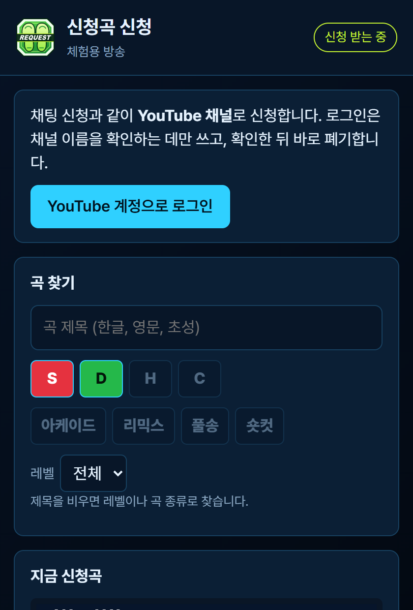{: width="360"}

- 바깥 주소로 열리는 것은 **신청 페이지(`/request`)뿐**입니다. 관리자 화면, 설정, OBS 오버레이는 이 PC에서만 열립니다. 바깥 주소의 첫 화면이 "허용되지 않은 주소입니다"인 것은 정상이고, 시청자에게는 끝에 `/request`가 붙은 주소를 알려 줍니다.
- 웹 신청도 채팅 신청과 같은 1인 제한, 중복 막기를 따르고, 들어오면 바로 대기열에 들어갑니다.
- 시청자가 신청하려면 [YouTube 로그인](#viewer-login)이 필요하므로 [OAuth 클라이언트](setup.md#oauth)가 있어야 합니다.

주소는 두 가지 중 하나를 고릅니다.

| | 임시 주소 | 고정 주소 |
|---|---|---|
| 비용 | 무료, 가입 없음 | 도메인 값(연 1~2만 원 정도), Cloudflare 가입 |
| 주소 | 켤 때마다 바뀜 (`…trycloudflare.com`) | 늘 같음 (`https://내도메인`) |
| 안정성 | 언제든 끊길 수 있음 | 안정적 |
| 준비 | [2번](#quick)만 하면 됨 | [3번](#fixed)을 한 번 해 둠 |

## 1. cloudflared 준비

두 방식 모두 Cloudflare가 무료로 주는 터널 프로그램 **cloudflared**를 씁니다.

1. [cloudflared 내려받기](https://github.com/cloudflare/cloudflared/releases/latest) 페이지에서 `cloudflared-windows-amd64.exe`를 받습니다.
2. `RequestHub.exe`가 있는 폴더(또는 그 위 폴더)에 넣습니다. 설치(msi)나 서비스 등록은 필요 없습니다. Request Hub가 필요할 때만 켜고, 끌 때 같이 끕니다.
3. 관리자 화면 **설정 → 외부 공개**의 **cloudflared** 칸에 파일 위치가 보이면 준비된 것입니다.

## 2. 임시 주소로 열기 {#quick}

1. **설정 → 외부 공개**에서 **웹 신청 받기**를 켭니다.
2. 주소 종류에서 **임시 주소**를 고르고 **공개 시작**을 누릅니다.
3. 수십 초 안에 **시청자에게 알려 줄 주소**가 나타납니다. **주소 복사**로 복사해 시청자에게 알려 줍니다.

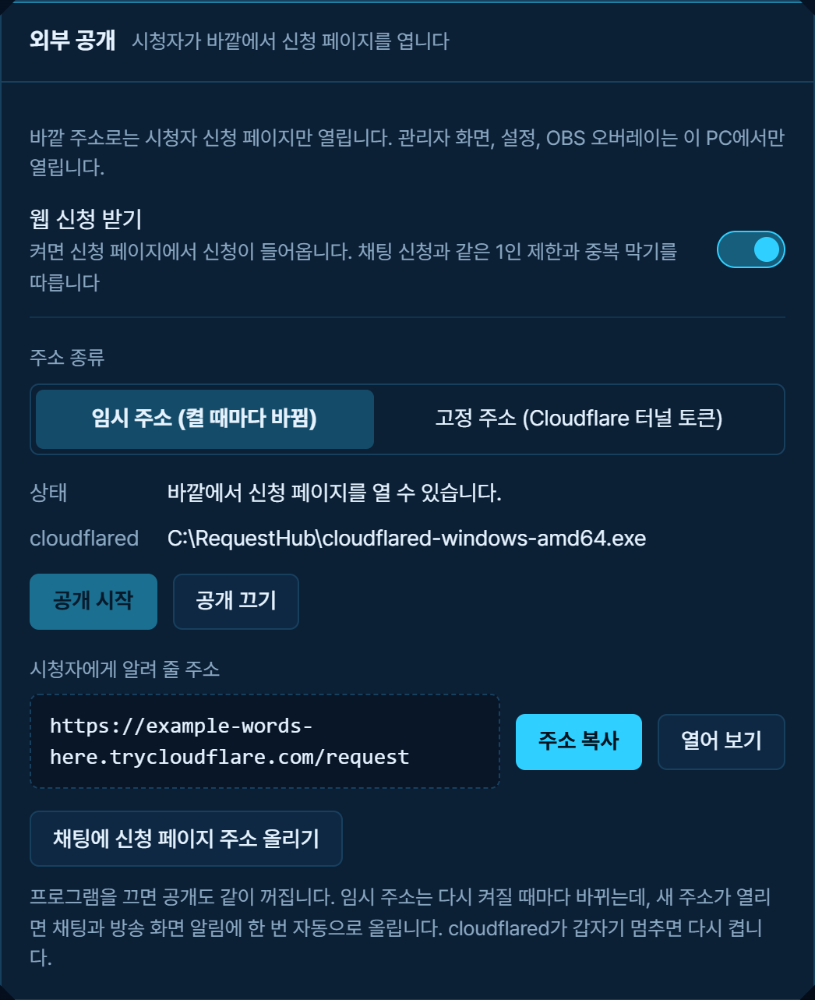{: width="520"}

**알아 둘 것**

- 임시 주소는 **켤 때마다 바뀌고, 무료라서 언제든 끊길 수 있습니다.** 신청 페이지에도 이 안내가 보입니다.
- cloudflared가 멈추면 Request Hub가 다시 켜고, 새 주소가 열리면 **채팅과 방송 화면 알림에 새 주소를 한 번 올립니다.** 채팅에 올리려면 방송인이 Google 로그인을 해 두어야 하고, 아직이면 로그인하는 즉시 올립니다.
- 언제든 **채팅에 신청 페이지 주소 올리기** 버튼으로 직접 알릴 수 있습니다.

## 3. 고정 주소로 열기 (내 도메인) {#fixed}

방송마다 같은 주소를 쓰려면 내 도메인과 Cloudflare 터널을 씁니다. 처음 한 번만 해 두면 그다음부터는 **공개 시작**만 누르면 됩니다.

### 3-1. 도메인 사기

1. [Cloudflare](https://dash.cloudflare.com/)에 가입하고 로그인합니다.
2. 왼쪽 메뉴 **도메인 → 등록**에서 **도메인 구매**를 누르고 원하는 도메인을 삽니다. 이미 다른 곳에서 산 도메인이 있으면 **도메인 → 개요**에서 Cloudflare에 연결해도 됩니다.

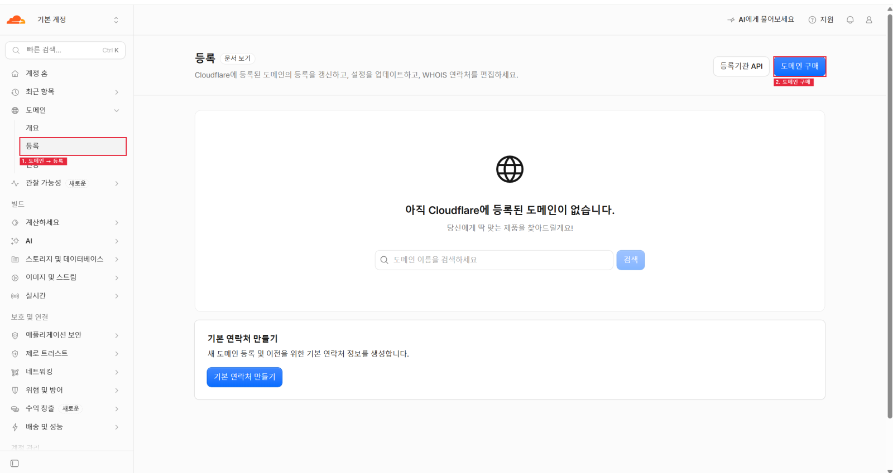

- 산 도메인 철자를 꼭 적어 두세요. 아래에서 넣는 주소가 한 글자라도 다르면 [주소를 찾을 수 없다는 오류](#trouble)가 납니다.
- 막 산 도메인은 쓸 수 있게 되기까지 몇 분 걸릴 수 있습니다.

### 3-2. 터널 만들고 토큰 복사하기

1. 왼쪽 메뉴 **보호 및 연결 → 네트워킹 → 터널**로 갑니다.
   - **제로 트러스트** 메뉴가 아닙니다. 예전 설명서에는 Zero Trust 안에 있다고 나오지만 지금은 네트워킹 아래에 있습니다.
2. **터널 만들기**에서 **Cloudflared**를 고르고, 이름(예: `RequestHub`)을 넣어 저장합니다.
3. 다음 화면의 **설치 및 실행** 칸에 나오는 명령어에서 **`eyJ`로 시작하는 긴 글자만** 복사합니다. 이것이 터널 토큰입니다.
   - 명령어 앞부분(`cloudflared.exe service install`)은 복사하지 않습니다.
   - 위에 나오는 **msi 내려받기, 설치 프로그램 실행, 명령 프롬프트 실행은 하지 않습니다.** Request Hub가 cloudflared를 대신 켭니다.
   - 토큰은 비밀번호와 같습니다. 다른 사람에게 보여 주거나 방송 화면에 띄우지 마세요.

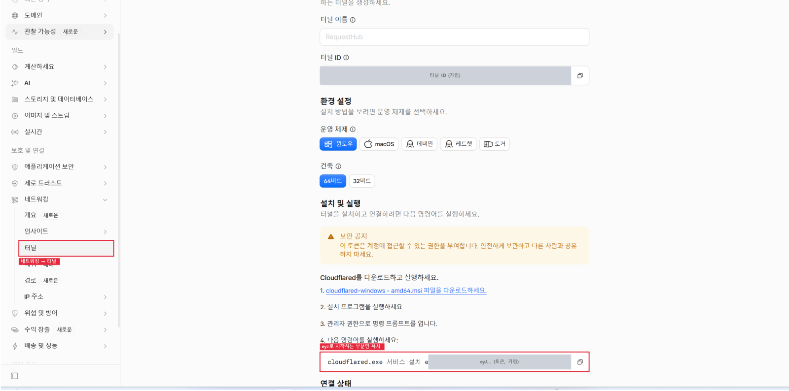

4. 이 화면 아래 **연결 상태**는 "터널 연결을 기다리는 중"이고 **계속** 버튼이 잠겨 있습니다. Cloudflare 창은 그대로 두고 Request Hub로 갑니다.

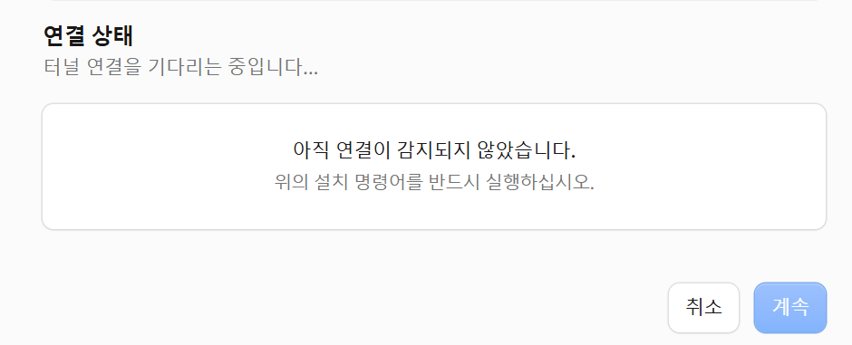{: width="520"}

### 3-3. Request Hub에 토큰 넣고 공개 시작

1. Request Hub **설정 → 외부 공개**에서 **웹 신청 받기**를 켭니다.
2. 주소 종류에서 **고정 주소 (Cloudflare 터널 토큰)**를 고릅니다.
3. **터널 토큰** 칸에 복사한 `eyJ…`를 붙여 넣고 **저장**을 누릅니다. 이 PC에 암호화해 저장되고, 칸 옆에 "(저장됨)"이 보입니다.
4. **공개 시작**을 누릅니다.

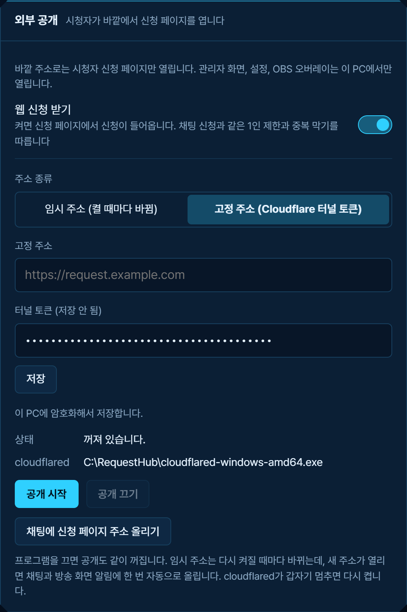{: width="520"}

5. Cloudflare 창으로 돌아가면 몇 초 안에 연결이 감지되고 **계속** 버튼이 열립니다. **계속**을 누릅니다.
   - 몇 분이 지나도 연결되지 않으면 Request Hub에서 토큰을 `eyJ`부터 끝까지 다시 붙여 넣고 저장한 뒤, **공개 끄기 → 공개 시작**을 해 보세요.

### 3-4. 경로 연결 (내 도메인 → 이 PC)

1. Cloudflare 터널 화면의 **Routes(경로)** 탭에서 **Add route → Published application**을 누릅니다. (터널을 처음 만들 때 이어서 나오는 화면에서 바로 넣어도 됩니다)
2. **도메인**에서 3-1에서 산 도메인을 고릅니다. 하위 도메인(예: `request`)은 비워 두어도 되고, 넣으면 `request.내도메인`이 됩니다.
3. **서비스**(Service URL)에 `http://localhost:8787` 을 넣습니다.
   - **`https`가 아니라 `http`**입니다. https로 넣으면 연결되지 않습니다(502 오류).
   - Request Hub의 포트를 바꿨다면 8787 대신 그 숫자를 넣습니다.
4. 저장합니다.

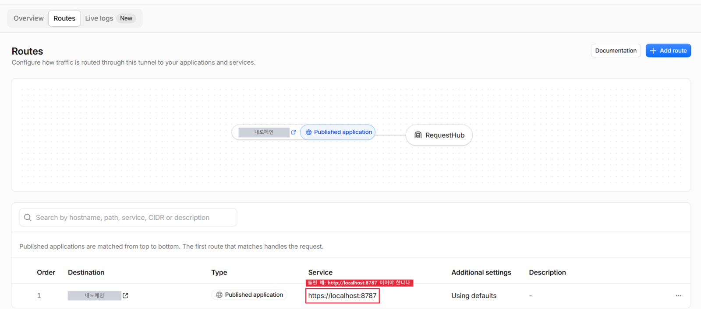

위 화면은 서비스를 `https://localhost:8787`로 넣은 **틀린 예**입니다. 오른쪽 **…** 메뉴의 편집으로 `http://localhost:8787`로 고치면 됩니다.

5. **Overview** 탭의 **Status**가 **Healthy**이면 터널이 연결된 것입니다.

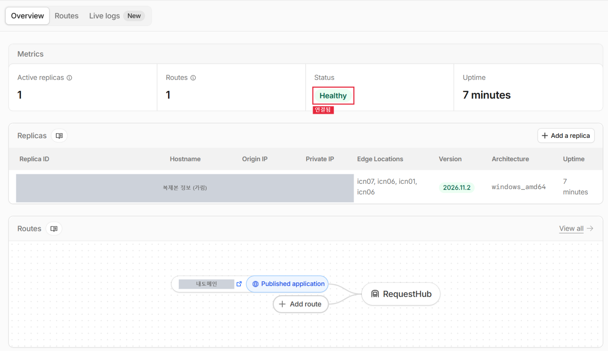

### 3-5. Request Hub에 고정 주소 넣기

1. **설정 → 외부 공개 → 고정 주소**에 `https://` 뒤에 3-4의 도메인(하위 도메인을 넣었다면 그것까지)을 **그대로** 넣습니다.
   - 예: `https://request.example.com`
   - `http://localhost:8787`은 Cloudflare의 서비스 칸에 넣는 주소입니다. 여기에 넣으면 안내가 뜨고 저장되지 않습니다.
   - 뒤에 `/request`는 붙이지 않습니다. 프로그램이 붙입니다.
2. **시청자에게 알려 줄 주소**에 `https://내도메인/request`가 보입니다. **열어 보기**로 신청 페이지가 열리는지 확인합니다.

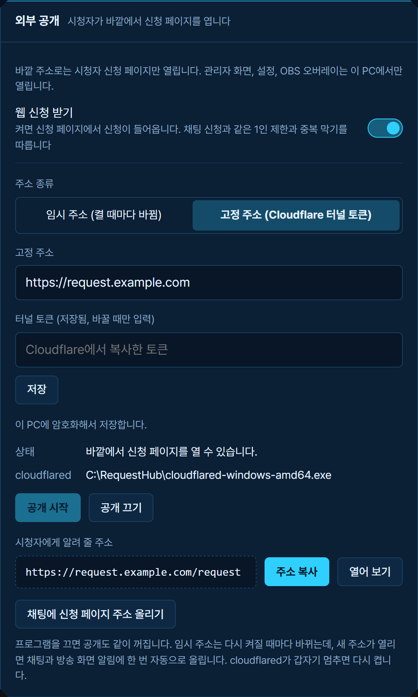{: width="520"}

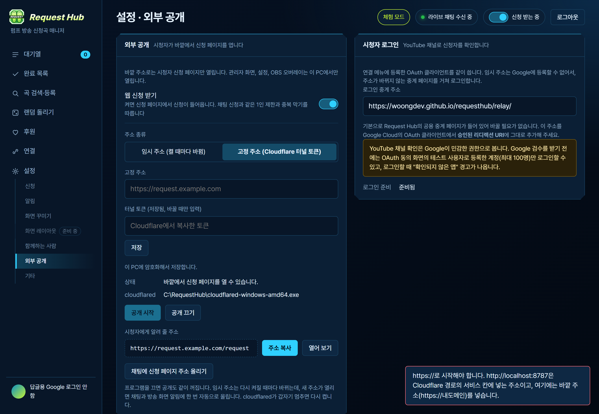

다음 방송부터는 Request Hub를 켜고 **설정 → 외부 공개 → 공개 시작**만 누르면 됩니다. 프로그램을 끄면 공개도 같이 꺼집니다.

## 4. 시청자 로그인 {#viewer-login}

시청자는 신청 페이지에서 **YouTube 계정으로 로그인**한 뒤 신청합니다. 채팅 신청처럼 YouTube 채널로 확인하므로 채팅으로 신청한 것과 같은 사람으로 셉니다. 로그인은 채널 이름을 확인하는 데만 쓰고, 확인한 뒤 Google 토큰은 바로 폐기합니다.

임시 주소는 Google에 등록할 수 없어서, 주소가 바뀌지 않는 **중계 페이지**(`https://woongdev.github.io/requesthub/relay/`)를 거쳐 로그인합니다. 중계 페이지는 로그인 결과를 지금 열린 신청 페이지로 넘겨주기만 하고 아무것도 저장하지 않습니다. 넘겨받은 결과는 방송인 PC의 Request Hub만 가진 값이 있어야 쓸 수 있습니다.

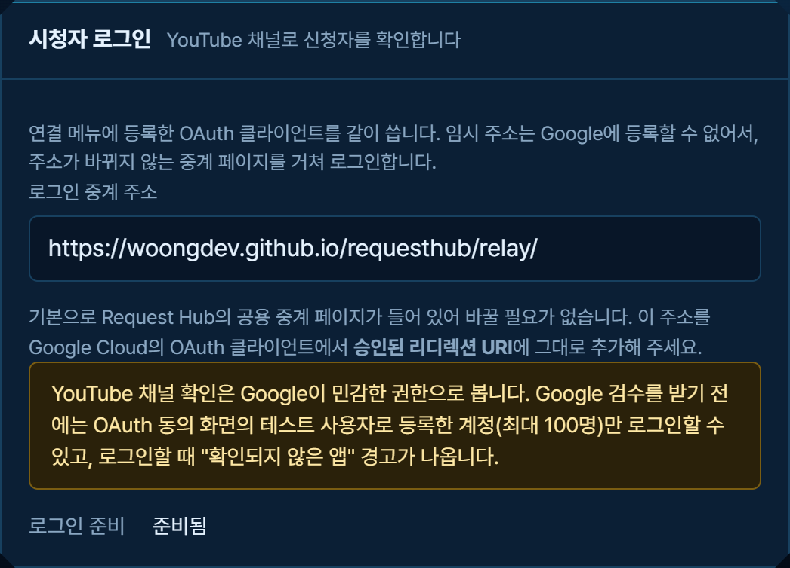{: width="520"}

방송인이 Google Cloud 콘솔에서 한 번 해 둘 일:

1. [OAuth 클라이언트](setup.md#oauth)의 승인된 리디렉션 URI에 `https://woongdev.github.io/requesthub/relay/`를 넣습니다.
2. **Google 인증 플랫폼 → 브랜딩 → 승인된 도메인**에 `woongdev.github.io`를 추가합니다.
3. **데이터 액세스 → 범위 추가 또는 삭제**에서 `…/auth/youtube.readonly`를 추가합니다.
4. **대상 → 테스트 사용자**에 로그인할 시청자의 Google 계정을 추가합니다.

Request Hub의 **로그인 중계 주소**는 기본값 그대로 두면 됩니다. **로그인 준비**가 "준비됨"이면 됩니다.

**테스트 상태의 제한**

- YouTube 채널 확인은 Google이 민감한 권한으로 봅니다. Google 검수를 받기 전(테스트 상태)에는 **테스트 사용자로 등록한 계정만, 최대 100명**까지 로그인할 수 있고, 로그인할 때 "확인되지 않은 앱" 경고 화면을 한 번 거칩니다.
- 이 제한은 방송인마다 자기 OAuth 클라이언트에 따로 걸립니다. 누구나 로그인하게 하려면 Google의 앱 검수를 받아야 합니다.

## 5. 문제가 생기면 {#trouble}

| 증상 | 확인할 것 |
|---|---|
| 바깥 주소 첫 화면이 "허용되지 않은 주소입니다" | 정상입니다. 끝에 `/request`를 붙인 주소를 쓰세요. |
| `DNS_PROBE_FINISHED_NXDOMAIN` (사이트에 연결할 수 없음) | 주소 철자가 산 도메인과 다르거나, 도메인이 아직 활성화되지 않았습니다. Cloudflare의 도메인 이름, 경로의 도메인, Request Hub의 고정 주소가 모두 같은지 한 글자씩 비교하세요. |
| 502 Bad Gateway | Request Hub가 꺼져 있거나, 경로의 서비스가 `https://`로 되어 있습니다. `http://localhost:8787`로 고치세요. |
| Cloudflare에서 연결을 계속 기다림, 라이브 로그가 비어 있음 | Request Hub에서 **공개 시작**을 눌렀는지, 토큰을 `eyJ`부터 끝까지 넣었는지 확인하세요. |
| cloudflared 칸이 "찾지 못했습니다" | `cloudflared-windows-amd64.exe`를 `RequestHub.exe`와 같은 폴더에 두세요. |
| 신청 페이지의 로그인 버튼이 눌리지 않음 | OAuth 클라이언트를 등록하지 않았습니다. **연결** 메뉴에서 등록하세요. |
| Google에서 "액세스 차단됨" | 그 시청자가 테스트 사용자에 없거나, 리디렉션 URI가 빠졌습니다. |
| 신청 페이지가 "웹 신청 꺼짐" | **설정 → 외부 공개 → 웹 신청 받기**가 꺼져 있습니다. |

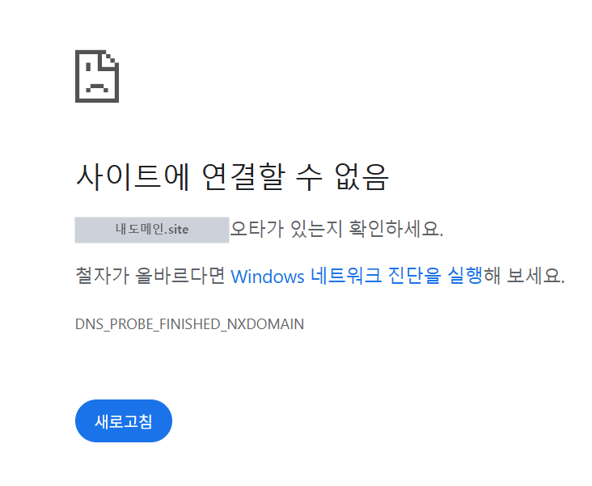{: width="420"}

[다음: 보안과 자주 묻는 질문 →](security.md)
